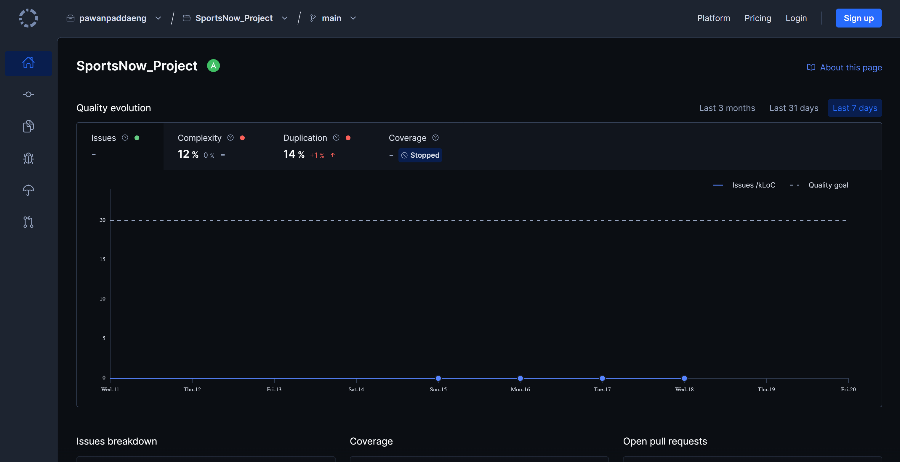
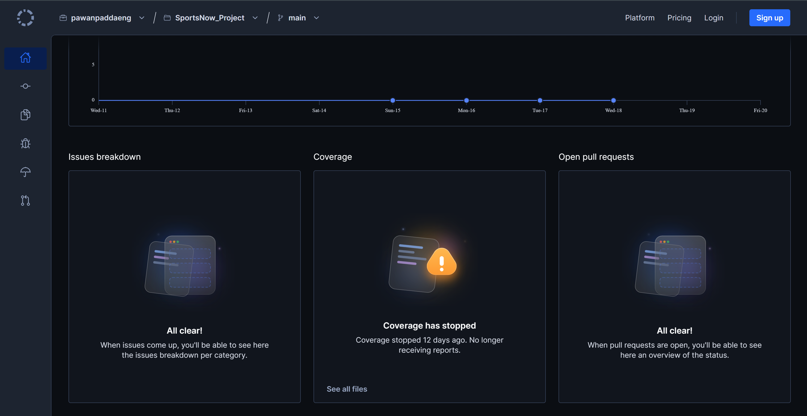
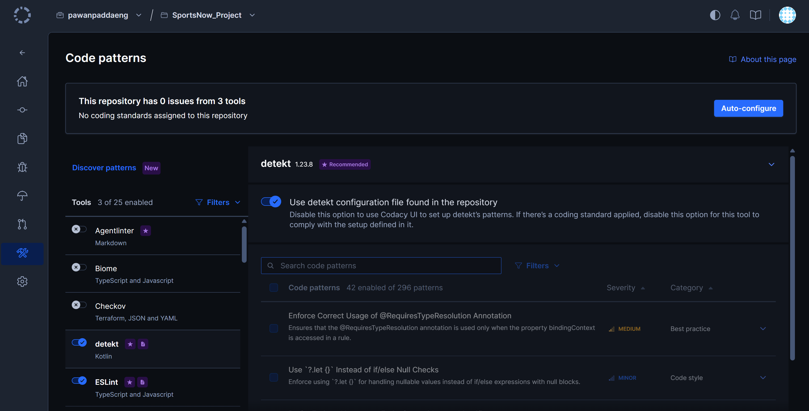

# Code Review

## 1. Change History

| **Change Date**   | **Modified Sections** | **Rationale** |
| ----------------- | --------------------- | ------------- |
| _4-Nov-2026_ | Section 2 pictures | Updating codacy report for new CP2 code |
| _18-Nov-2026_ | Section 3 | Added the CP3 manual code review: the review we wrote of MatchMarket, the review MatchMarket wrote of SportsNow, and what we changed in response, up to commit `9a2d507`. Both reports are in `documentation/res/`. |

---

## 2. Automated Code Review Results

### 2.1. Commit Hash Where Codacy Ran

`7ba4248da9b96ccb74851be2b4eae3cedf0c8f87`

### 2.2. Unfixed Issues per Codacy Category

### 2.3. Unfixed Issues per Codacy Code Pattern

### 2.4. Justifications for Unfixed Issues

There are no unfixed Codacy issues at this commit, so no justifications are needed.

Codacy reports high duplication but that comes from test files rather than source code.

---

## 3. Manual Code Review Results

### 3.1. Review You Performed

- **Peer group reviewed:** MatchMarket
- **Commit SHA reviewed:** 1fba57f837b2ea16f32ac258ef019d8f29002898
- **Date the artifacts were exchanged:** 04-11-2026
- **Review report submitted:** 

| **Section**          | **Item**                                                                                                                                             | **Score** |
| -------------------- | ---------------------------------------------------------------------------------------------------------------------------------------------------- | --------- |
| Manual code review   | Code is maintainable (well-documented, uses self-explanatory variable names, does not have complicated and long methods, magic numbers, etc.), efficient, handles error cases well | 8.5/10      |
| Manual test review   | Tests are complete (all APIs exposed to the front-end are tested, three main features are tested), errors and edge cases are thoroughly tested, correct assertions are used | 9/10      |
| Manual test review   | Test code is maintainable and well-structured                                                                                                          | 8/10      |
| Manual test review   | Test implementation matches the requirements and design                                                                                                | 8/10      |
| Manual test review   | Non-functional requirements are tested well                                                                                                            | 5/10      |
| Manual test review   | Tests achieve high coverage and cases of < 100% coverage are well-justified                                                                            | 6/10      |
| Manual test review   | All back-end tests can be run automatically                                                                                                            | 10/10      |
| Automated code review| Codacy runs with the required setup                                                                                                                    | 10/10      |
| Automated code review| All remaining Codacy issues are well-justified                                                                                                          | 10/10      |

The tests were scored against the CP2 scope: one end-to-end feature and all interfaces of one component.

**Main findings**

- **Code:** methods are small, with good names and no magic numbers. Files have no top-level explanation, and there is no description of the code structure, so finding where something is done means opening files one by one. The front end mixes screens with models and API calls outside the `ui` folder, and some names are confusing (`DealsModel.kt` and `DealModels.kt`). The back end has many files of a few lines, such as a whole file for one interface. When a proposal is accepted, `closePosts` rewrites each whole post document to change only its status.
- **Requirements and design:** links in Requirements and Design don't work. "Create deal" reads like a user action. Use Case 1 mixes two flows (create a request and create a listing), so it's unclear which flow each failure 5a–5d belongs to. Use Case 3 describes the ranking algorithm in detail, which the user never sees. The sequence diagrams show mostly the success path, with one failure each, and some database writes have no reply. The address field has to be typed from memory, and a map picker would help.
- **Tests:** the Deals component's 5 interfaces each have a mocked and an unmocked group that check the database after each call, with edge cases such as a 4 KB body, a second rating and two edits at once. The Create Post end-to-end test runs every scenario of Use Case 1 for both requests and listings, and checks the back end when nothing should be saved. Deductions: a mocked test accepts a rating saved without its reputation update as expected behaviour, the end-to-end tests wait a fixed 2 seconds after airplane mode, and `assertTrue(size == 1)` doesn't report the actual count.
- **Docs and coverage:** Testing.md describes an older commit (164 tests rather than 220) and older coverage screenshots, and its table lists only the Deals interfaces. Formal Use Cases 2–5 have no end-to-end tests. Only NFR 2 has a test. Combined coverage was 66.95% of statements and 49.36% of branches, justified only for Deals.
- **Automation and Codacy:** a GitHub Actions workflow runs the type check, the interface tests and the NFR test on every push and pull request. Codacy runs with the required setup and reports no issues.

**Major fault reported**

- **Description:** On a physical device using MatchMarket's deployed back end, no photos load anywhere in the app.
- **Steps to reproduce:** [WRITE_HERE: e.g. 1. Install MatchMarket's APK on a physical Android phone. 2. Sign in, using the deployed back end. 3. Open any screen that shows photos.]
- **Screenshots:** [WRITE_HERE]
- **Severity:** [WRITE_HERE]

### 3.2. Review You Received

- **Reviewing group:** MatchMarket
- **Commit SHA that was reviewed:** eccf7d9343f9ef4d088c1da59cb5ecf89106b622
- **Review report received:** 

| **Section**          | **Item**                                                                                                                                             | **Score** |
| -------------------- | ---------------------------------------------------------------------------------------------------------------------------------------------------- | --------- |
| Manual code review   | Code is maintainable, efficient, handles error cases well                                                                                               | 8/10      |
| Manual test review   | Tests are complete, errors and edge cases are thoroughly tested, correct assertions are used                                                            | 5/10      |
| Manual test review   | Test code is maintainable and well-structured                                                                                                          | 8/10      |
| Manual test review   | Test implementation matches the requirements and design                                                                                                | 5/10      |
| Manual test review   | Non-functional requirements are tested well                                                                                                            | 0/10      |
| Manual test review   | Tests achieve high coverage and cases of < 100% coverage are well-justified                                                                            | 5/10      |
| Manual test review   | All back-end tests can be run automatically                                                                                                            | 5/10      |
| Automated code review| Codacy runs with the required setup                                                                                                                    | 7/10      |
| Automated code review| All remaining Codacy issues are well-justified                                                                                                          | 8/10      |

MatchMarket also scored against the CP2 scope. The NFR score of 0 only records that no NFR tests existed yet, since they were due at CP3.

**Main findings**

- **Code (C1–C5):** (C1) signing out doesn't unregister the phone's FCM token, so the signed-out phone still gets that user's notifications. (C2) `searchUsers` reads every user and compares their names in Node. (C3) the reputation score hides bad behaviour: missing ratings count as 5 stars, new players start at a perfect 5.0, and only the last 5 games count. (C4) Discover can wait up to 10 seconds for a location fix, but NFR 1 promises results in under 5 seconds. (C5) Requirements and Design section 4.1 didn't list complete game, leave game and delete account, and marked remove player as planned.
- **Tests:** the Game component's 13 interfaces have 75 tests, and many check the database. But there was no end-to-end test, only Android Studio's example. Missing edge cases: sign-in failures, 5 of the 6 planned `createGame` validation tests, `removePlayer` errors and its mocked test, and `completeGame`'s `not_started`, `completed` and database failure. 75 of the 84 test files held one test, so their setup was repeated.
- **Docs and automation:** Testing.md wasn't updated for CP2 (line links, commit hash, test database setup, GitHub Actions location and end-to-end logs), and there was no GitHub Actions workflow.
- **Codacy:** `@Suppress("DEPRECATION")` at `game/location/Geocoding.kt:51` breaks the rule against inline suppression. The screenshot shows the Code patterns page instead of the Issues page, and the 14% duplication is dismissed without evidence.

**Major fault reported against your project**

- **Description:** a player can leave a game after it has started. Leaving deletes their row from `game_players`, and when the organiser marks the game completed, attendance is only written for players still in `game_players`. So the organiser can't mark the player as a no-show, nobody can rate them, and the game doesn't affect their reputation score, although it still counts towards their games played. A player who never came can leave from home after the start time and avoid both the no-show penalty and ratings.
- **Severity:** Medium-High. Reputation and catching no-shows are the core of the app, but the player has to leave on purpose, and the app doesn't crash or leak data.

### 3.3. Actions Taken in Response to the Review

Up to commit [`9a2d507`](https://github.com/pawanpaddaeng/SportsNow_Project/commit/9a2d5079786c71c4ed5e68b18b0af7f25217f4ab) on `main`.

| **Finding** | **Action Taken** | **Commit / Location in Git** |
| ----------- | ---------------- | ---------------------------- |
| No end-to-end test (Tests 2.1, 2.5) | Wrote end-to-end tests for Discover Game, Join Game, View Upcoming Games, Leave Game and game chat, with a seed script for their data, and for the Friend System (Search Users, Send and Decline Friend Request, Accept Friend Request and chat). Testing.md section 4 maps each scenario step to the test steps. | `7235f9b`, `d06036b`, `5984d8e`, `2199065`, `0a10b05`, `d2c2ea2` (PR #89); `c80a2a9`, `c62664a`, `910b97d`, `ab741f1` (PR #88). [`frontend/app/src/androidTest/java/com/example/cpen321application/e2e/`](../frontend/app/src/androidTest/java/com/example/cpen321application/e2e/) |
| No GitHub Actions workflow (Tests 2.6) | Added a workflow that starts a fresh MySQL database and runs the back-end interface tests on pushes to `main`, on pull requests and by hand. Testing.md section 2.2 points to it. | `82259ad`, `ac1faab`. [`.github/workflows/backend-tests.yml`](../.github/workflows/backend-tests.yml) |
| No NFR tests (Tests 2.4) | Each non-functional requirement now has a back-end test and a front-end test. Discover is timed on the server with 1,000 games and on the phone from tapping Discover to the list showing. Chat messages are timed on the server and on the phone. | `2ac752c`. [`backend/tests/nfr/`](../backend/tests/nfr/), [`frontend/app/src/androidTest/java/com/example/cpen321application/nfr/`](../frontend/app/src/androidTest/java/com/example/cpen321application/nfr/), Testing.md section 3 |
| Testing.md not updated for CP2: line links and test database setup (Tests 2.3, 2.6) | Section 2.1.1 links each `describe` group by file and line, and section 2.1.3 explains how to start the test database and run the tests. | `085376b`. [`documentation/Testing.md`](Testing.md) |
| Only one component's interfaces tested (Tests 2.1) | Every component's interfaces now have tests with and without mocks: Friend, Review, Chat (including the WebSocket), Notifications and User, as well as Game. | `2f46871` (Friend), `e80143e`, `3b5f469`, `63c5176` (Review), `64755b5`, `e6d019b` (Chat), `f3800a7`, `b75cc49`, `7370316` (Notifications), `bdba486` (User). [`backend/tests/`](../backend/tests/) |
| Sign-in failure tests missing (Tests 2.1) | The User and Friend tests now check that calls without a sign-in are rejected, and that sign-up and login reject an ID token Google didn't sign. | `bdba486`, `3e234d4`. [`backend/tests/no-mock/user/`](../backend/tests/no-mock/user/) |
| 75 of 84 test files hold one test, so setup is repeated (Tests 2.2) | The Game tests now have one file per interface, and the test folders match the source folders. | `05de4bb`, `774e0ef`, `2eafe1d`. [`backend/tests/no-mock/game/`](../backend/tests/no-mock/game/) |
| Reputation score hides bad behaviour (C3) | The score was redesigned. A player nobody has rated shows "Not rated yet" instead of 5.0. The score starts from a baseline worth 3 games, so one game can't swing it, and it counts the last 50 games with newer games weighing more, instead of the last 5. A no-show scores 1 star, and unusual games weigh less. Ratings now use 6 stars. Someone who showed up but didn't rate still counts as the baseline, 5 of 6 stars. | `01253f6`, `f96d043`, `2dae83f`. [`backend/src/review/reputation.ts`](../backend/src/review/reputation.ts), [`backend/src/review/outliers.ts`](../backend/src/review/outliers.ts) |
| Requirements and Design section 4.1 doesn't match the code (C5) | Section 4.1 now lists complete game, leave game and delete account, and remove player is marked as built and only for the organiser. | `182219f`. [`documentation/Requirements_and_Design.md`](Requirements_and_Design.md) |

- **Findings not acted on yet.** At commit `9a2d507` these are still open:
  1. **Finding:** Major fault: leaving a game after it starts erases it from the player's score.
     - **Justification:** Not fixed yet. We agree it's a bug: our own comments say leaving after the start shouldn't erase the game from a player's score. Planned fix: write the attendance rows from the approved join requests and the organiser, instead of from the players still in the game. `leaveGame` already keeps the join request approved once the game has started.
  2. **Finding:** `@Suppress("DEPRECATION")` at `game/location/Geocoding.kt:51` (Codacy 3.1).
     - **Justification:** Not removed yet. It has to go, since the course doesn't allow inline suppression. The deprecated `getFromLocation` call is the only geocoding call on Android 12 and older, so the call stays and the warning it causes is accepted.
  3. **Finding:** Signing out doesn't unregister the phone's FCM token (C1).
     - **Justification:** Not fixed yet. Planned fix: a route that deletes the phone's token, called on sign-out together with `FirebaseMessaging.deleteToken()`.
  4. **Finding:** Discover can wait up to 10 seconds for a location fix, longer than NFR 1's 5 seconds (C4).
     - **Justification:** Not changed yet. The front-end NFR test now times Discover on the phone from the tap to the list, but it runs with a location fix available. Planned fix: shorten `CURRENT_FIX_TIMEOUT_MS` in `DeviceLocation.kt` so Discover fits in 5 seconds, falling back to the last known fix.
  5. **Finding:** `searchUsers` reads every user and compares their names in Node (C2).
     - **Justification:** Search also finds similar names, not only exact ones, so a name typed with a typo or still being typed is found ("pwa" finds "Pawan", see `backend/src/friend/search/nameMatch.ts`). MySQL can't score how similar two names are, and a SQL `LIKE` pre-filter would drop exactly those misspelled matches. Each search reads one row per user, which is small at the scale of this course project. If the number of users grows, a pre-filter on the first letters or a full-text index could narrow the rows first.
  6. **Finding:** Missing Game edge-case tests: `createGame` validation (1 of 6), `removePlayer` errors and its mocked test, and `completeGame`'s `not_started`, `completed` and database failure (Tests 2.1, 2.5).
     - **Justification:** Not written yet.
  7. **Finding:** Testing.md has no test commit hash, coverage screenshots or end-to-end logs (Tests 2.3).
     - **Justification:** Not added yet. Sections 2.1.2, 2.3 and 2.4 still say "To be added at CP2", and the end-to-end logs are added once the tests pass on User A's emulator.
  8. **Finding:** The Codacy screenshot shows the Code patterns page instead of the Issues page, and the 14% duplication is dismissed without evidence (Codacy 3.1, 3.2).
     - **Justification:** Not updated yet. Section 2 still shows the CP2 run at commit `7ba4248`. It will be replaced with a new run's Overview and Issues pages.