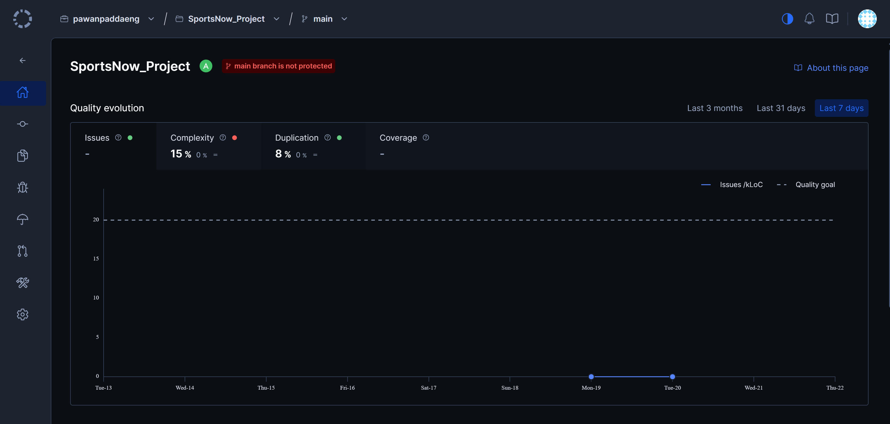
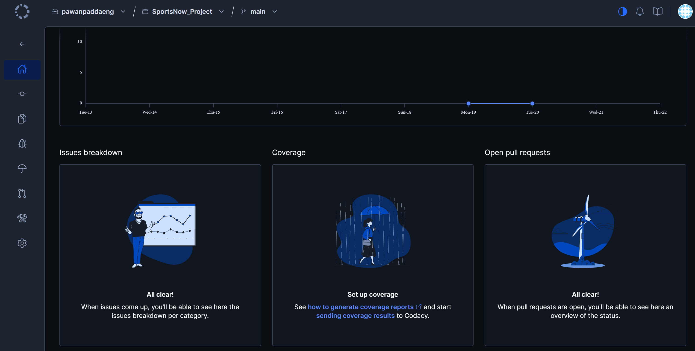
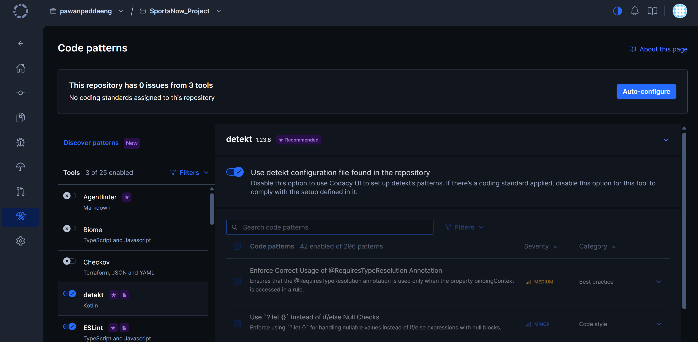

# Code Review

## 1. Change History

| **Change Date**   | **Modified Sections** | **Rationale** |
| ----------------- | --------------------- | ------------- |
| _Nothing to show_ |

---

## 2. Automated Code Review Results

### 2.1. Commit Hash Where Codacy Ran

`363c564e2122d5faa4a972a74499b5ab6367ec77`

### 2.2. Unfixed Issues per Codacy Category

### 2.3. Unfixed Issues per Codacy Code Pattern

### 2.4. Justifications for Unfixed Issues

There are no unfixed Codacy issues at this commit, so no justifications are needed.

Codacy reports low duplication (8%), but 15% of files are marked as complex. We plan to reduce it in a later milestone by decresing nested code and the number of complex files.

---

## 3. Manual Code Review Results

### 3.1. Review You Performed

- **Peer group reviewed:** [WRITE_HERE]
- **Commit SHA reviewed:** `[Insert Commit SHA here]`
- **Date the artifacts were exchanged:** [WRITE_HERE]
- **Review report submitted:** [`<CP#>_<YourPeerGroupName>_Review.pdf`](#)

| **Section**          | **Item**                                                                                                                                             | **Score** |
| -------------------- | ---------------------------------------------------------------------------------------------------------------------------------------------------- | --------- |
| Manual code review   | Code is maintainable (well-documented, uses self-explanatory variable names, does not have complicated and long methods, magic numbers, etc.), efficient, handles error cases well | x/10      |
| Manual test review   | Tests are complete (all APIs exposed to the front-end are tested, three main features are tested), errors and edge cases are thoroughly tested, correct assertions are used | x/10      |
| Manual test review   | Test code is maintainable and well-structured                                                                                                          | x/10      |
| Manual test review   | Test implementation matches the requirements and design                                                                                                | x/10      |
| Manual test review   | Non-functional requirements are tested well                                                                                                            | x/10      |
| Manual test review   | Tests achieve high coverage and cases of < 100% coverage are well-justified                                                                            | x/10      |
| Manual test review   | All back-end tests can be run automatically                                                                                                            | x/10      |
| Automated code review| Codacy runs with the required setup                                                                                                                    | x/10      |
| Automated code review| All remaining Codacy issues are well-justified                                                                                                          | x/10      |

**Major fault reported**

- **Description:** ...
- **Steps to reproduce:** ...
- **Screenshots:** _(Placeholder for screenshots of the reported fault)_
- **Severity:** ...

### 3.2. Review You Received

- **Reviewing group:** [WRITE_HERE]
- **Commit SHA that was reviewed:** `[Insert Commit SHA here]`
- **Review report received:** [`<CP#>_<YourGroupName>_Review.pdf`](#)

| **Section**          | **Item**                                                                                                                                             | **Score** |
| -------------------- | ---------------------------------------------------------------------------------------------------------------------------------------------------- | --------- |
| Manual code review   | Code is maintainable, efficient, handles error cases well                                                                                               | x/10      |
| Manual test review   | Tests are complete, errors and edge cases are thoroughly tested, correct assertions are used                                                            | x/10      |
| Manual test review   | Test code is maintainable and well-structured                                                                                                          | x/10      |
| Manual test review   | Test implementation matches the requirements and design                                                                                                | x/10      |
| Manual test review   | Non-functional requirements are tested well                                                                                                            | x/10      |
| Manual test review   | Tests achieve high coverage and cases of < 100% coverage are well-justified                                                                            | x/10      |
| Manual test review   | All back-end tests can be run automatically                                                                                                            | x/10      |
| Automated code review| Codacy runs with the required setup                                                                                                                    | x/10      |
| Automated code review| All remaining Codacy issues are well-justified                                                                                                          | x/10      |

**Major fault reported against your project**

- **Description:** ...
- **Severity:** ...

### 3.3. Actions Taken in Response to the Review

| **Finding** | **Action Taken** | **Commit / Location in Git** |
| ----------- | ---------------- | ---------------------------- |
| ...         | ...              | [`src/...`](#)               |
| ...         | ...              | ...                          |

- **Findings not acted on.** For each finding you decided not to address, give the reason:
  1. **Finding:** ...
     - **Justification:** ...
