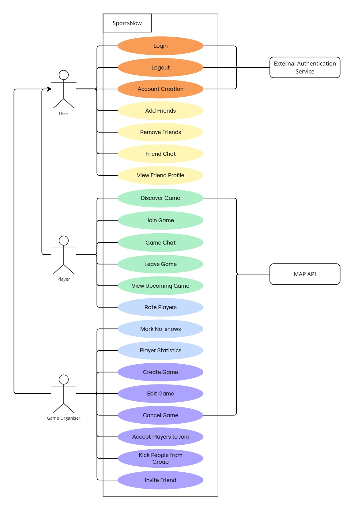

# Requirements and Design

## 1. Change History

| **Change Date**   | **Modified Sections** | **Rationale** |
| ----------------- | --------------------- | ------------- |
| Oct 31, 2026 | 4.1, 4.2, 4.4 | Game chat is built. Section 4.1 now lists the Message component's real interfaces, and a chat closes through the game's status instead of a separate `closeGameChat` call. Section 4.2 stores chat messages in MySQL instead of MongoDB, because the 1 GB server doesn't have the memory to run a second database. Section 4.4 removes the MongoDB driver and marks `ws` as in use. |

---

## 2. Project Description
SportsNow is a mobile app that helps people find like-minded players for sports games. Organisers can create games and set the sport, time, location, number of players, and the skill level they are looking for. Nearby players can browse these games and request to join. Users can also add friends, chat with them, and invite them to games.

To keep the community made up of accurately skilled players, SportsNow builds a reputation for every user. After each game, players rate one another on punctuality, sportsmanship, skill and reliability, and organisers record no-shows. These ratings feed a reputation score, and players also earn badges for milestones. Organisers see each requester’s score, history, and badges before accepting or rejecting them, so games are filled with reliable players.

---

## 3. Requirements Specification

### **3.1. List of Features**
1. Authentication: To access app features, a user must Sign In using Google Authentication Service first. New users must set up a profile by providing their first name, last name, and birth year. Users can also sign out.

2. Game Planning: A user can create a game by specifying the sport, title, date, start time, max players, skill level, and an optional description. The user picks the game location on a map using the Google Maps API. Every player who wants to join must send a join request that the organiser approves. The organiser can then review join requests, each shown with the player’s rating, history, and badges, and can accept or reject each one. The join request list updates live as new requests arrive. The Game Organiser can also invite friends and edit or cancel the game. Each game has a temporary real-time chat room, which is closed after the game ends.

3. Game Discovery: A user can browse a list of games near their location, or near a place they choose on a map using the Google Maps API. Games are sorted by distance and can be filtered by sport. A user can view game details and the organiser’s reputation, and can send a join request with their skill level, how often they play, and an optional message. The user is notified when a request is accepted or rejected, and the game status updates automatically. A user can also view upcoming games and leave a game before it starts.

4. Friend System: A user can search for other users and send, accept, or decline friend requests. A user can remove a friend. Friends can chat in real-time direct chat. A user can view a friend’s profile, badges, and upcoming games, and can invite them to games.

5. Player Reputation and Statistics: After each game, players rate each other on punctuality, sportsmanship, skill, and reliability, along with an overall rating, and the organiser marks players who did not show up. Our algorithm computes a reputation score, weighting recent games more heavily, adjusting for the number of ratings, and penalising no-shows and late cancellations. The score updates after every game and is shown to organisers reviewing join requests. Milestones and badges are awarded automatically: “10 Games Completed”, “5 Games in One Week”, “Reliable Player”, “Always On Time”, and “Hosted 5 Games”. Badges are displayed on the user’s profile.

### **3.2. Use Case Diagram**

### **3.3. Actors Description**
1. User: A user is anyone with a SportsNow account. A user signs up, logs in, signs out, manages friends, chats with friends, rates players, and views player statistics.
2. Player: A player is a user who joins games. A player discovers nearby games, requests to join them, and chats with other participants. A player builds a reputation and earns badges over time.
3. Game Organiser: A game organiser is a user who creates games. A game organiser creates and manages games, reviews join requests using each player’s stats, and invites friends to a game.

### **3.4. Use Case Description**
#### - Use cases for Feature 1 Authentication: 
1. Login: A returning user opens the app and signs in by verifying their identity with Google.
2. Logout: A logged-in user signs out of their account and is returned to the first screen. 
3. Account Creation: A new user opens the app and signs up. The user verifies their identity with Google, then provides their first name, last name, and birth year.

#### - Use cases for Feature 2 Friend System: 
4. Add Friends: A user searches for another user and sends them a friend request, which the other user can accept or decline. 
5. Remove Friends: A user removes someone from their list of friends. 
6. Friend Chat: A user chats with one of their friends. The user selects a friend from their friend list, opens the chat, and sends a message.
7. View Friend Profile: A user views a friend’s profile, including their badges and upcoming games.

#### - Use cases for Feature 3 Game Discovery: 
8. Discover Game: A player finds games happening nearby. The system uses the player’s location, or a place they choose on the map, to show nearby games and their information, and the player can filter the list by sport.
9. Join Game: A player views the details of a game and sends a request to join it, stating their skill level, how often they play, and an optional message. 
10. Game Chat: Players who have joined a game chat with the other participants in a temporary chat room, which is closed after the game ends. 
11. Leave Game: A player who has joined a game withdraws from it before it starts. 
12. View Upcoming Games: A user views the upcoming games they organise and the games they have joined.

#### - Use cases for Feature 4 Player Reputation and Statistics: 
13. Rate Players: After a game has finished, a user rates the other players. The user selects a player and rates them on punctuality, sportsmanship, skill, and reliability, along with an overall rating.
14. Mark No-shows: After a game has finished, the game organiser marks the players who did not show up.
15. Player Statistics: A user views their player’s statistics, including their reputation score and the badges they have earned. 

#### - Use cases for Feature 5 Game Planning: 
16. Create Game: A game organiser creates a new game by entering its details and selecting a location on the map.
17. Edit Game: A game organiser changes the details of a game they created, such as the date, time, or location. 
18. Cancel Game: A game organiser cancels a game they created, and its players are notified.
19. Accept Players to Join: A game organiser reviews the join requests for their game, using each player’s rating, history, and badges, and accepts or rejects each one. 
20. Kick People from Group: A game organiser removes a player from a game they created. 
21. Invite Friend: A game organiser invites one or more of their friends to a game they created. 

### **3.5. Formal Use Case Specifications (5 Most Major Use Cases)**

#### **Use Case 1: Create Game**

**Description**: A Game Organiser creates a new game by entering its details and selecting a location on the map.

**Primary actor(s)**: Game Organiser

**Preconditions**: Game Organiser is logged in

[**[Sequence Diagram]**](#seq-uc1)
    
**Main success scenario**:
1. Game Organiser selects “Create game”.
2. System displays the game creation form with fields for the sport, title, date, time, max players, skill level, description (optional), and a map for selecting the location.
3. Game Organiser fills in all the details and clicks on the map.
4. System opens the Map API.
5. Game Organiser selects the game location on the map.
6. System determines and displays the address of the selected location, then closes the map.
7. Game Organiser clicks “Create game”.
8. System creates the game and displays a confirmation message.

**Failure scenario(s)**:
- 4a. System cannot connect to the Map API.
    - 4a1. System displays an error message and lets the Game Organiser try again.
- 6a. The Map API cannot determine an address for the selected location.
    - 6a1. System displays an error message and asks the Game Organiser to select another location.
- 7a. Game Organiser left a compulsory field empty or did not select a location.
    - 7a1. System displays an error message identifying the missing fields.
- 7b. Game Organiser entered an invalid value in any field.
    - 7b1. System displays an error message identifying the invalid field and the reason.
- 8a. The game could not be created.
    - 8a1. System displays a message saying the game could not be created, along with the reason.

#### **Use Case 2: Discover Game**

**Description**: A player finds games happening nearby. The system uses the player’s location, or a place they choose on the map, to show nearby games and their information, and the player can filter the list by sport.

**Primary actor(s)**: Player 

**Preconditions**: Player is logged in

[**[Sequence Diagram]**](#seq-uc2)

**Main success scenario**: 
1. Player selects the compass in the navigation bar 
2. System gets the Player’s location from the phone.
3. System displays the nearby games sorted by distance with their information, and a selector bar at the top with various sports.
4. Player selects a sport in the selector bar.
5. System updates the list to show only the games of the selected sport.

**Failure scenario(s)**:
- 2a. System cannot get the Player’s location (e.g. location is turned off or location access is denied).
    - 2a1. System displays an error message and lets the Player try again or choose a place on the map.
- 3a. No games are found nearby.
    - 3a1. System displays a message saying no nearby games were found.
- 5a. No nearby games are found for the selected sport.
    - 5a1. System displays a message saying no games were found of the selected sport.

#### **Use Case 3: Join Request**

**Description**: A player sends a request to join a game, stating their skill level, how often they play, and an optional message. The request waits for the organiser’s approval.

**Primary actor(s)**: Player

**Preconditions**: Player is logged in and is viewing the details of a game they have not joined

[**[Sequence Diagram]**](#seq-uc3)
    
**Main success scenario**:
1. Player selects “Request to join”.
2. System displays the join request form with fields for skill level, how often they play (optional), and a message (optional).
3. Player fills in the form and clicks “Send request”.
4. System sends the request to the organiser and shows the request as pending.

**Failure scenario(s)**:
- 3a. Player did not select a skill level.
    -  3a1. System displays an error message asking the Player to select their skill level.
- 4a. The request could not be sent.
    -  4a1. System displays a message saying the request could not be sent, along with the reason.

#### **Use Case 4: Friend Chat**

**Description**:  A user chats with one of their friends. The user selects a friend from their friend list, opens the chat, and sends a message.

**Primary actor(s)**: User

**Preconditions**: User is logged in and has at least one friend

[**[Sequence Diagram]**](#seq-uc4)

**Main success scenario**:
1. User selects “Chat”.
2. System displays the list of the user’s friends.
3. User selects a friend.
4. System opens the chat with that friend.
5. User types a message and clicks “Send”.
6. System sends the message to the friend

**Failure scenario(s)**:
- 5a. User clicked “Send” without typing a message.
    - 5a1. System does not send anything and keeps the chat open.
- 6a. The message could not be sent (e.g. no internet connection).
    - 6a1. System displays a message saying the message could not be sent and lets the user try again.

#### **Use Case 5: Rate Players**

**Description**: After a game has finished, a user rates the other players. The user selects a player and rates them on punctuality, sportsmanship, skill, and reliability, along with an overall rating.

**Primary actor(s)**: User

**Preconditions**: User is logged in and has finished a game
    
[**[Sequence Diagram]**](#seq-uc5)

**Main success scenario**:
1. User selects the finished game from the home menu.
2. System opens the game details.
3. User selects “Rate player”.
4. System displays all the players of the game.
5. User selects a player.
6. System displays the rating categories of punctuality, sportsmanship, skill, and reliability, each out of 5, as well as an overall rating.
7. User enters the ratings and clicks “Submit”.
8. System records the rating and displays a confirmation message.

**Failure scenario(s)**:
- 7a. User did not give a rating for one or more categories.
    - 7a1. System displays an error message identifying the missing ratings.
- 8a. The rating could not be submitted (e.g. no internet connection).
    - 8a1. System displays a message saying the rating could not be submitted along with a reason for the failure

### **3.6. Screen Mock-ups**

### **3.7. Non-Functional Requirements**

1. **Performance**
    - **Description**: Discover Game should finish loading and display the nearby games in under 5 seconds from when the user selects the compass.
    - **Justification**: In Nielsen’s Response Times: The 3 Important Limits, about 10 seconds is the limit for keeping the user’s attention focused, and delays between 1 and 10 seconds make users feel at the mercy of the computer and explore less freely. Within that range, real user monitoring data from Gomez, cited by Countey (2015), shows that websites loading within 5 seconds keep abandonment to about 20%. This figure is for websites, where a visitor can leave at no cost. SportsNow users have chosen to install the app, so they are more committed and should abandon even less at the same delay. A 5-second target therefore sits well inside Nielsen’s 10-second limit and in the range where abandonment is low. 

2. **Energy Efficiency**
    - **Description**: Using the app for 10 minutes should reduce the phone’s battery level by no more than 1%.
    - **Justification**: People spend an average of 4 hours and 37 minutes on their phones each day. If an average user drains about 80% of their battery over that time, the average phone uses roughly 17% of its battery per hour of use (80% ÷ 4.62 hours). SportsNow is not designed to be as energy intensive as typical apps such as video, games, or social media, so its target is about one-third of that rate, or 6% per hour. A drain of 1% per 10 minutes meets this target and helps avoid battery concerns, which Ickin et al. (2017) found to be one of the top reasons users uninstall apps. 

---

## 4. Designs Specification
### **4.1. Main Components**
All front-end to back-end interfaces are HTTP/REST calls that send and return JSON. Every endpoint except sign up and login needs the JWT from sign up or login in the `Authorization: Bearer <token>` header. Back-end components call each other directly in the same Node.js process, and those interfaces are written as Java-style method signatures.

1. **User**
    - **Purpose**: Handles sign up, login, sign out, and user profiles, verifying identity through Google Authentication.
    - **Rationale**: Keeping accounts in their own component lets every other component get the signed in user from one place. We chose Google sign in with our own JWT over username and password accounts so we never store passwords.
    - **Interfaces**: 
        1. `POST /api/auth/signup` body `{ id_token, email, f_name, l_name, birthYear }` → `201 { msg: "signedIn", jwt_token }`
            - **Purpose**: Verifies the Google ID token, creates the user's account, and returns a JWT for later requests.
        2. `POST /api/auth/login` body `{ id_token }` → `200 { msg: "signedIn", jwt_token }` or `404 { msg: "no_user" }`
            - **Purpose**: Verifies the Google ID token and returns a JWT if the user already has an account.
        3. `POST /api/register_notif` body `{ fcm_token }` → `200 { msg: "success" }`
            - **Purpose**: Saves the device's Firebase token so the server can send the user push notifications.
        4. `GET /api/users/me` → `200 { user }`
            - **Purpose**: Returns the signed in user's profile.
        5. `PUT /api/users/me` body `{ f_name, l_name, birthYear }` → `200 { user }`
            - **Purpose**: Updates the signed in user's profile.
        6. `User findUserById(int userId)`
            - **Purpose**: Used by the other components to get a user's name and details, returning null if no user has the id.
        7. `int sendPushToUser(int userId, PushMessage message)`
            - **Purpose**: Sends a push notification to every device the user is signed into and returns how many devices it reached.

2. **Game**
    - **Purpose**: Handles creating, editing, discovering, joining, and leaving games, accepting and removing players, and invitations, using the Google Maps API for locations.
    - **Rationale**: Games, their players and join requests change together, so one component owns them and can lock a game while it changes, so two approvals at once can't go over the player limit. We chose to search by distance in a MySQL query over loading every game into the server so Discover Game stays fast.
    - **Interfaces**: 
        1. `POST /api/games` body `{ title, sport, description, starts_at, ends_at, location_name, address, latitude, longitude, max_players, skill_level }` → `201 { game }`
            - **Purpose**: Creates a game with the signed in user as its organiser and first player.
        2. `GET /api/games/mine` → `200 { organized_games, joined_games }`
            - **Purpose**: Returns the games the user organises and the games they have joined.
        3. `GET /api/games/discover?lat=&lng=` → `200 { games }` or `200 { msg: "no_games" }`
            - **Purpose**: Returns the nearby games the user can join, closest first.
        4. `GET /api/games/{gameId}` → `200 { game, organizer, players, viewer_role, chat_id }`
            - **Purpose**: Returns a game's details, its players, and what the signed in user can do with it.
        5. `PUT /api/games/{gameId}` body same as create → `200 { game }`
            - **Purpose**: Lets the organiser edit the details of their game.
        6. `POST /api/games/{gameId}/cancel` → `200 { game }`
            - **Purpose**: Lets the organiser cancel their game and notifies its players.
        7. `POST /api/games/{gameId}/join-requests` body `{ skill_level, play_frequency, message }` → `201 { request }`
            - **Purpose**: Sends a join request for a game and notifies the organiser.
        8. `GET /api/games/{gameId}/join-requests` → `200 { game, requests }`
            - **Purpose**: Returns the pending join requests for the organiser to review.
        9. `PATCH /api/games/{gameId}/join-requests/{requestId}` body `{ decision: "approve" | "decline" }` → `200 { game }`
            - **Purpose**: Lets the organiser approve or decline a join request and notifies the requester.
        10. `DELETE /api/games/{gameId}/players/{userId}` → `200 { game }` *(planned)*
            - **Purpose**: Lets a player leave a game, or the organiser remove a player, before the game starts.
        11. `POST /api/games/{gameId}/invites` body `{ friend_ids }` → `201 { msg: "success" }` *(planned)*
            - **Purpose**: Lets the organiser invite friends to their game by notifying them.
        12. `List<GamePlayer> getGamePlayers(int gameId)`
            - **Purpose**: Used by Player Review and Message to check who played in a game.
        13. `List<Game> getFinishedGames(int userId)` *(planned)*
            - **Purpose**: Used by Player Review to find the user's finished games that can be rated.

3. **Player Review**
    - **Purpose**: Handles player ratings after a game, no-shows, reputation scores, and badges.
    - **Rationale**: The reputation score and badges are computed from ratings, so keeping them apart from games keeps the scoring algorithm in one place. We chose to recompute the score after each game over computing it on every profile view so profiles load quickly.
    - **Interfaces**: *(planned)*
        1. `POST /api/games/{gameId}/ratings` body `{ rated_user_id, punctuality, sportsmanship, skill, reliability, overall }` → `201 { msg: "success" }`
            - **Purpose**: Records a user's rating of another player after a finished game.
        2. `POST /api/games/{gameId}/no-shows` body `{ user_ids }` → `200 { msg: "success" }`
            - **Purpose**: Lets the organiser mark players who did not show up.
        3. `GET /api/users/{userId}/stats` → `200 { reputation_score, games_played, badges }`
            - **Purpose**: Returns a user's reputation score, game history, and badges.
        4. `Reputation getReputation(int userId)`
            - **Purpose**: Used by Game to show each requester's score and badges on the join request list.
        5. `void updateReputation(int gameId)`
            - **Purpose**: Recomputes the score of every player in a finished game and awards any new badges.

4. **Message**
    - **Purpose**: Handles chat messages for both game chat and friend chat.
    - **Rationale**: Game chat and friend chat send and store messages the same way, so one component handles both. We chose a WebSocket connection over polling so messages arrive live and the app doesn't use battery asking for new ones.
    - **Interfaces**: Game chat is built. Friend chat is *(planned)* and will use the same interfaces.
        1. `GET /api/chats/{chatId}/messages?before=` → `200 { messages, is_closed }`
            - **Purpose**: Returns 50 of the chat's earlier messages, newest first, to a current player of the game. `before` is the oldest message id the app already has. `is_closed` is true once the game is completed or cancelled.
        2. WebSocket `send_message { chat_id, text, client_id }` → `new_message { message, client_id }`, or `error { msg, error, client_id }`
            - **Purpose**: Sends a message and delivers it live to everyone in the chat. The connection needs `?chat_id=` and the user's JWT, and only opens for a current player of the game. Sending fails with `chat_closed` once the game is completed or cancelled, so the chat can still be read but not written to. `client_id` lets the app match a reply to the message it sent.
        3. `int createGameChat(Queryable connection, int gameId)`
            - **Purpose**: Used by Game to open the chat room for a new game in the same transaction that creates the game, returning its chat id.

5. **Social**
    - **Purpose**: Handles friend search, friend requests, removing friends, and viewing friends' profiles.
    - **Rationale**: Friendships are used by friend chat, game invites and friend profiles, so one component owns them. We chose to keep it apart from User so the User component only handles accounts and profiles.
    - **Interfaces**: *(planned)*
        1. `GET /api/users/search?q=` → `200 { users }`
            - **Purpose**: Searches for users by name.
        2. `POST /api/friends/requests` body `{ user_id }` → `201 { request }`
            - **Purpose**: Sends a friend request and notifies the other user.
        3. `PATCH /api/friends/requests/{requestId}` body `{ decision: "accept" | "decline" }` → `200 { msg: "success" }`
            - **Purpose**: Accepts or declines a friend request.
        4. `GET /api/friends` → `200 { friends }`
            - **Purpose**: Returns the user's friends.
        5. `DELETE /api/friends/{userId}` → `200 { msg: "success" }`
            - **Purpose**: Removes a friend.
        6. `GET /api/friends/{userId}` → `200 { user, badges, upcoming_games }`
            - **Purpose**: Returns a friend's profile with their badges and upcoming games.
        7. `boolean areFriends(int userId, int otherUserId)`
            - **Purpose**: Used by Message and Game to check that two users are friends before a chat or invite.

### **4.2. Databases**
1. **Relational Database (MySQL)**
    - **Purpose**: Stores users, games, players, join requests, device tokens, chats and their messages, friendships, and ratings.
    - **Rationale**: This data has clear links between tables and needs transactions, such as locking a game while a join request is approved. We chose MySQL over a document database for these joins and transactions. Chat messages are stored here too, instead of in a second database, because the 1 GB server doesn't have the memory to run both, and checking who can read a chat already needs the game and player tables.

### **4.3. External Modules**
1. **Google Authentication** 
    - **Purpose**: Verifies users’ identity when they sign up and log in.
    - **Rationale**: We chose it over our own password accounts so we don't store passwords, and most Android users already have a Google account.
    - **Interface**: `OAuth2Client.verifyIdToken(String idToken, String audience)` → `LoginTicket` holding the Google account id and verified email.
2. **Google Maps API** 
    - **Purpose**: Provides the map for selecting a game location and determines addresses, and gives the location for nearby game search.
    - **Rationale**: We chose it over OpenStreetMap because it is made for Android, is well documented, and uses the same Google Cloud project as Google sign in.
    - **Interface**: `GoogleMap(CameraPositionState cameraPositionState, Function<LatLng, Unit> onMapClick)` from the Maps SDK for Android, which shows the map in the app and returns the coordinates of the spot the user taps.
3. **Firebase Cloud Messaging** 
    - **Purpose**: Sends push notifications, such as new join requests and request decisions, to users' phones.
    - **Rationale**: We chose it over keeping a connection open or polling the server because it is built into Android and saves battery.
    - **Interface**: `BatchResponse messaging.sendEachForMulticast(MulticastMessage message)`, which sends a title, body and data to a list of device tokens and reports which tokens no longer work.

### **4.4. Frameworks and Libraries**
#### Back-end
1. **Node.js with TypeScript**
    - **Purpose**: Runs the back-end server.
    - **Reason**: TypeScript's types catch mistakes in request and database fields before the code runs, and Node.js handles many requests at once without threads.
2. **Express.js**
    - **Purpose**: Routes HTTP requests to the handlers for each component and parses JSON bodies.
    - **Reason**: It is small, well known, and lets us split the routes into one router per component.
3. **mysql2**
    - **Purpose**: Connects to the MySQL database and runs queries and transactions.
    - **Reason**: It supports connection pools, transactions and parameterised queries, which keep queries safe from SQL injection.
4. **google-auth-library**
    - **Purpose**: Verifies the Google ID token the app sends when signing up or logging in.
    - **Reason**: It is Google's own library, so it checks the token's signature and audience correctly.
5. **jsonwebtoken**
    - **Purpose**: Creates and checks the JWT the app sends with every request after signing in.
    - **Reason**: A JWT lets the server know who the user is without storing sessions.
6. **firebase-admin**
    - **Purpose**: Sends push notifications to users' phones through Firebase Cloud Messaging.
    - **Reason**: It is the official way for a server to send Firebase notifications and reports tokens that no longer work.
7. **ws**
    - **Purpose**: Keeps a WebSocket connection open while a chat screen is shown so messages arrive live.
    - **Reason**: It is a small WebSocket library that works with the Express server.
8. **dotenv**
    - **Purpose**: Loads settings such as the database password and Google client id from a `.env` file.
    - **Reason**: It keeps secrets out of the code.
9. **Jest and Supertest**
    - **Purpose**: Run the back-end tests and send test HTTP requests to the server.
    - **Reason**: Jest is the most used Node.js test framework, and Supertest calls the Express app without starting a real server.

#### Front-end
1. **Kotlin with Jetpack Compose (Material 3)**
    - **Purpose**: Builds the Android app and its screens.
    - **Reason**: Compose is Android's recommended UI toolkit, and building screens in Kotlin code is quicker than XML layouts.
2. **Navigation Compose**
    - **Purpose**: Moves between the app's screens.
    - **Reason**: It is the standard navigation library for Compose apps.
3. **Retrofit with Gson and OkHttp**
    - **Purpose**: Makes the HTTP requests to the back-end and turns the JSON replies into Kotlin objects. OkHttp also keeps the chat's WebSocket connection open.
    - **Reason**: Retrofit turns each endpoint into one Kotlin function, which keeps the network code short.
4. **Credential Manager with Google ID**
    - **Purpose**: Shows the Google sign in prompt and gets the Google ID token.
    - **Reason**: It is Android's current recommended way to sign in with Google.
5. **Firebase Cloud Messaging**
    - **Purpose**: Gets the device's notification token and receives push notifications.
    - **Reason**: It is built into Android and works with the firebase-admin library on the back-end.
6. **Maps Compose, Play Services Maps and Places**
    - **Purpose**: Show the map for picking a game location and discovering games, and search for places by name.
    - **Reason**: Maps Compose lets us use Google Maps directly in Compose screens.

### **4.5. Dependencies Diagram**

### **4.6. Use Case Sequence Diagram (5 Most Major Use Cases)**
1.  [**Use Case 1: Create Game**](#uc1r)\

  

2.  [**Use Case 2: Discover Game**](#uc2r)\

  

3.  [**Use Case 3: Join Request**](#uc3r)\

  

4.  [**Use Case 4: Friend Chat**](#uc4r)\

  

5.  [**Use Case 5: Rate Players**](#uc5r)\

  

### **4.7. Design of Non-Functional Requirements**
1. [**Performance**](#nfr1)
    - **Implementation**: The front-end sends a single request to the Game component, which gets the nearby games with one MySQL query that filters by distance, sorts them closest first, and returns a limited number of games. The front-end shows a loading indicator while it waits, and filters the list by sport on the phone without sending another request.
2. [**Energy Efficiency**](#nfr2)
    - **Implementation**: The app requests the user’s location once when Discover Game opens, not continuously, and it doesn’t poll the server in the background. Updates such as join request results arrive as push notifications through Firebase, and chat uses a connection that is open only while the chat screen is shown.
